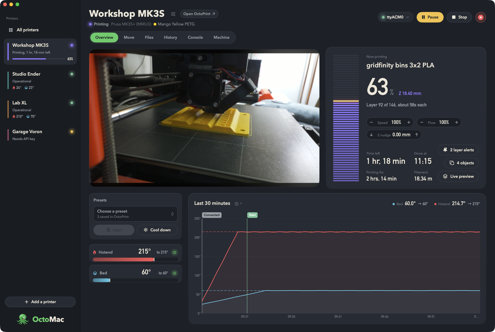
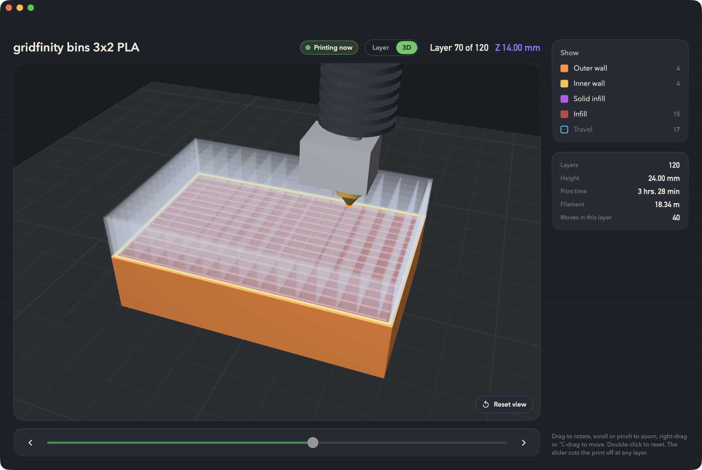
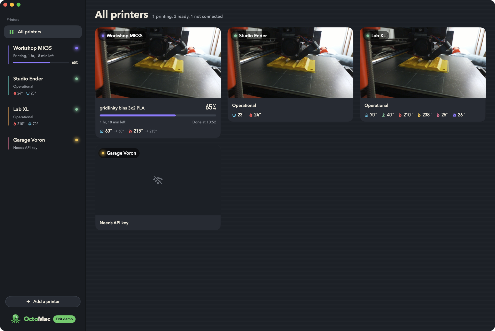
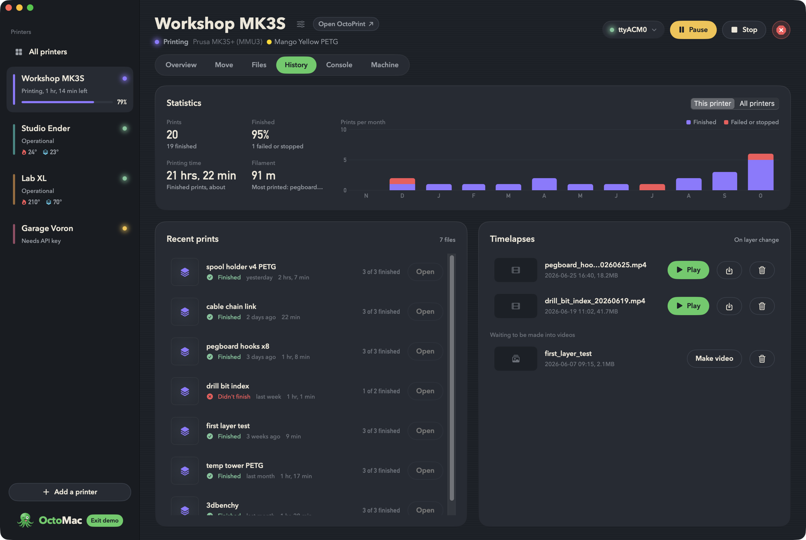
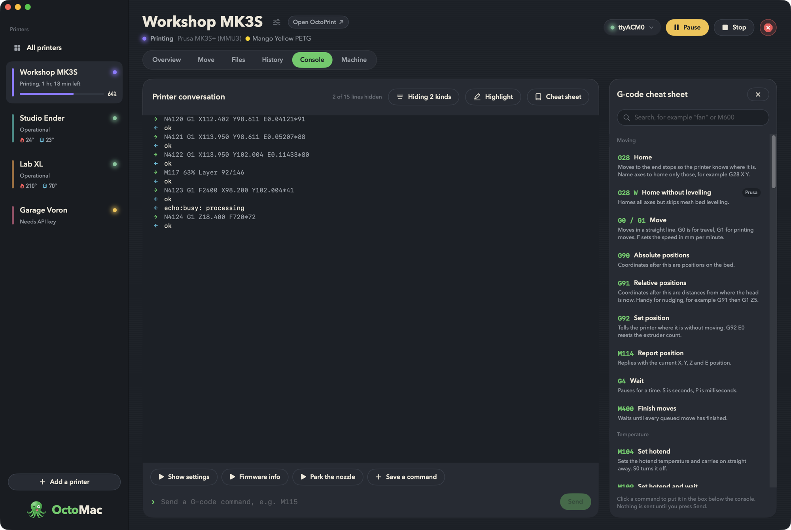
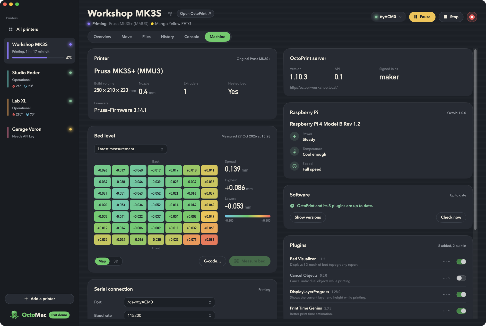
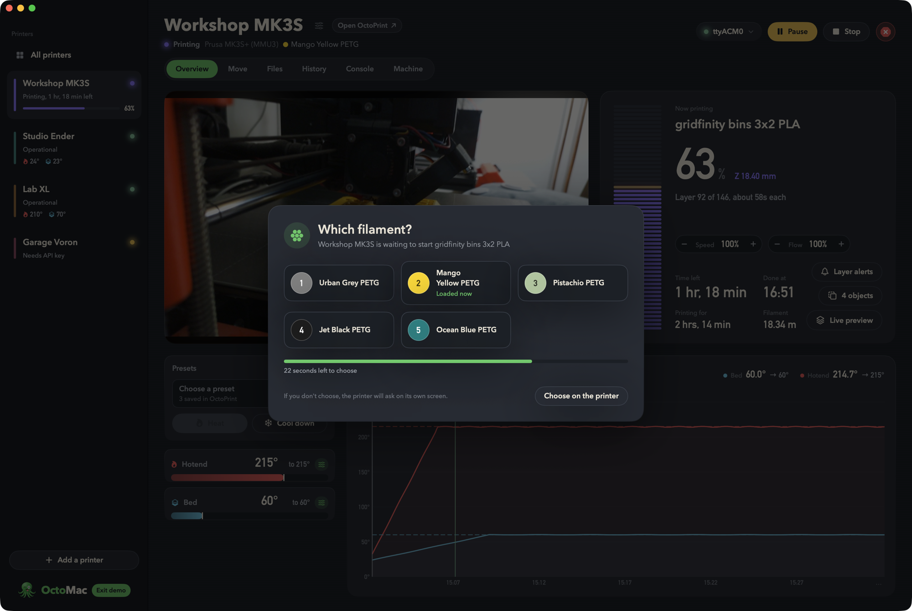

<picture>
  <source media="(prefers-color-scheme: dark)" srcset="docs/logo-dark.png">
  
</picture>

**A friendly Mac app for your OctoPrint 3D printers.**

OctoMac puts all of your [OctoPrint](https://octoprint.org) printers in one place, with a design built for watching and running prints rather than a web page squeezed into a window. Keep an eye on every printer at a glance, start a print in a couple of clicks, and watch it build up in 3D as it goes.



## What it does

- **All your printers, side by side.** Add as many OctoPrint servers as you like. Each one shows its status, temperatures and print progress in the sidebar, switching between them is instant, and **All printers** shows every camera and print at once.
- **Live updates.** OctoMac listens to OctoPrint's live connection, so temperatures, progress and events appear the moment they happen. No waiting, no refreshing.
- **A clear overview.** See the webcam (switch between cameras if you have more than one, with a cinema mode, one-click snapshots, and a picture in picture window that floats above your other apps), the current print with time left and when it'll finish, and a temperature chart you can hover over and export as PNG or SVG.
- **Print in a couple of clicks.** Browse your files as thumbnails, filter by name, open one to check its print time, filament and history, then press Print.
- **Easy uploads and tidy folders.** Drag G-code onto the Files tab to upload it, or open a `.gcode` file from Finder (or drop it on OctoMac in the Dock) and pick a printer. Drag files onto folders to organise them. Send a file to another printer, or to several at once, and start it printing there if you like.
- **History, statistics and timelapses.** The History tab shows how many prints finished, the hours and filament they took, and a month-by-month chart for one printer or all of them. It lists what you've printed lately and whether it finished, and plays, saves or deletes OctoPrint's timelapse videos.
- **Your own buttons.** Custom controls set up in OctoPrint appear on the Move tab, including ones that ask for a value first.
- **G-code preview.** See exactly what will be printed, layer by layer or as a 3D model you can spin around.
- **Watch prints live.** While printing, the 3D preview follows along, with a little animated nozzle laying down the current layer.
- **Tweak a print as it runs.** Nudge the print speed and flow right from the Overview while you watch.
- **Notifications.** Get a Mac notification when a print finishes or fails, when the printer needs you (a filament change, a paused print, an MMU filament choice), if it stops answering, or if the Raspberry Pi is short of power. Finished, failed and paused prints come with a picture from the camera. Choose which ones you want in Settings.
- **Know your machine.** The Machine tab shows the printer's firmware, the Raspberry Pi's power and temperature health, OctoPrint and plugin updates you can install with one click, your plugins (switch them on or off, or uninstall them), and OctoPrint's logs, which you can read or save. If the printer won't connect, OctoMac tells you why in plain words.
- **Full control.** Heat up with your saved presets, move the print head, extrude filament, adjust fan and speed, send G-code from the console, and manage the connection and the Raspberry Pi.
- **A friendlier console.** Hide the chatter you don't need (temperatures, SD status, positions, wait and busy replies, MMU chatter) using OctoPrint's own filters, and highlight the lines you care about, including the printer's replies to your own commands. The console holds still while you scroll up to read, and a G-code cheat sheet slides out beside it with plain explanations of common commands.
- **Safe by design.** Stopping a print asks you to confirm and shows what you'd lose, and there's a separate emergency stop for when something goes wrong.
- **Widgets.** Add OctoMac to your desktop or Notification Centre to see each printer's progress, time left and temperatures, with a camera picture in the large size. On macOS 26 there's a Control Centre control too.
- **A menu bar helper.** Check on every printer from the menu bar without opening the main window.
- **Progress on the Dock icon.** A bar across OctoMac's Dock icon shows how far along the print that finishes soonest is.
- **Keyboard shortcuts.** ⌥⌘1 to ⌥⌘9 jump between printers and ⌥⌘0 shows them all. ⌥⌘P pauses or resumes the print on screen, and ⌥⌘C pops its camera out into picture in picture. ⌘1 to ⌘6 switch tabs.
- **Celsius or Fahrenheit.** Celsius by default; switch in Settings.











## Getting started

### What you need

- A Mac running **macOS 15 Sequoia** or newer
- One or more printers running **OctoPrint** (for example on an OctoPi Raspberry Pi)
- An **OctoPrint admin account** for OctoMac to use. OctoMac expects full access (settings, system commands, logs and so on) and isn't designed for accounts with limited permissions.

### Download

Grab the latest **OctoMac.dmg** from the [Releases page](https://github.com/OctoMac-App/OctoMac/releases), open it, and drag OctoMac into your Applications folder. It runs on both Apple silicon and Intel Macs. OctoMac checks for new versions once a day and asks before installing one; you can turn that off in **Settings → General**.

### Or build it yourself

You'll need **Xcode 16** or newer.

```sh
git clone https://github.com/OctoMac-App/OctoMac.git
cd OctoMac
scripts/build-app.sh
open build/OctoMac.app
```

The finished app is at `build/OctoMac.app`. Drag it into your Applications folder to keep it.

You can also open `Package.swift` in Xcode and press Run.

### Add your first printer

1. Click **Add your first printer**.
2. Pick your printer from **On your network** (OctoMac finds OctoPrint servers on your local network automatically), or type its address, such as `octopi.local` or `http://192.168.1.50`. HTTPS works too: if your OctoPrint uses a self-signed certificate, OctoMac shows its fingerprint and asks whether to trust it, then only ever accepts that exact certificate from that printer.
3. Choose **Request access** and sign in to OctoPrint as an admin. Your browser opens OctoPrint, where you approve OctoMac with one click. (Prefer to paste an API key instead? Choose **Paste a key**.)
4. That's it. Your printer appears in the sidebar.

**Reaching OctoPrint from outside your home?** If it's behind a reverse proxy that asks for its own sign-in (nginx or Caddy with a password, Cloudflare Access and so on), open **Sign-in** when adding the printer and enter the user name and password, or the headers it needs, such as `CF-Access-Client-Id` and `CF-Access-Client-Secret`. OctoMac sends them only to that printer's address.

Your API keys stay on your Mac. By default they're kept in an encrypted file only your account can read; if you'd rather use the macOS Keychain, switch it on in **Settings → Printers**. See [PRIVACY.md](PRIVACY.md) for exactly what OctoMac stores, and what it doesn't.

### Just looking?

Try OctoMac without a printer: choose **Help → Try Demo Mode**. Your own printers stay saved, and **Exit demo** brings them back. You can also start straight into demo mode:

```sh
open build/OctoMac.app --args --demo
```

Demo mode shows four pretend printers, including one that's busy printing and a four-hotend tool-changer, so you can explore every screen safely.

## Plugin support

OctoMac works with a standard OctoPrint install, and it gets better with a few popular plugins.

| Plugin | What OctoMac does with it | Status |
| --- | --- | --- |
| [Slicer Thumbnails](https://plugins.octoprint.org/plugins/prusaslicerthumbnails/) | Shows the picture your slicer embeds in each G-code file, in the file list, the file browser, the file info panel and while printing. Works with PrusaSlicer, SuperSlicer, OrcaSlicer, Cura and others. | Supported |
| Application Keys (built in) | Lets you connect a printer by approving OctoMac in your browser, with no copying and pasting of API keys. | Supported |
| Classic Webcam (built in) | Shows your camera stream, including your flip and rotate settings. | Supported |
| Logging (built in) | Lists OctoPrint's log files on the Machine tab, so you can read the latest lines or save a whole log. | Supported |
| Pi Support (built in) | Shows the Raspberry Pi model and warns when it's short of power or too hot. | Supported |
| Software Update (built in) | Shows whether OctoPrint and your plugins are up to date. | Supported |
| [Bed Level Visualizer](https://plugins.octoprint.org/plugins/bedlevelvisualizer/) | Shows your bed mesh on the Machine tab as a colour map with every probe point's height, or as a 3D surface you can turn. Measure the bed again with one click, and pick the measuring G-code from ready-made starting points. | Supported |
| [Print Time Genius](https://plugins.octoprint.org/plugins/PrintTimeGenius/) | Uses its much more accurate print times for files and time left, and says when a time comes from it. Without it, OctoMac uses OctoPrint's own estimates. | Supported |
| [Cancel Objects](https://plugins.octoprint.org/plugins/cancelobject/) | While printing several parts at once, shows them on a map of the bed and lets you stop one that's failed while the others carry on. | Supported |
| [DisplayLayerProgress](https://plugins.octoprint.org/plugins/DisplayLayerProgress/) | Shows the real layer number while printing (for example "Layer 92 of 146, about 58s each"). | Supported |
| [Prusa MMU](https://plugins.octoprint.org/plugins/prusammu/) | When a print starts on a printer with a Prusa Multi Material Unit, asks which filament to use, showing your filament names and colours and a countdown. You can answer from any screen, or press the slot's number. The loaded filament also shows next to the printer's name. | Supported |

Don't have a plugin installed? No problem. OctoMac simply skips that feature. For example, without Slicer Thumbnails your files show a tidy icon instead of a picture.

Want OctoMac to support a plugin you use? Open an issue and tell us about it.

### Bed Level Visualizer: measuring the bed

Bed Level Visualizer needs to know which G-code makes your printer probe the bed and report the result. In OctoMac, open the **Machine** tab and choose **G-code…** in the Bed level panel. Pick a starting point, then save:

- **Prusa MK3S and MK2.5S:** `@BEDLEVELVISUALIZER`, `G28 W`, `G80`, `G81`
- **Marlin with a probe:** `@BEDLEVELVISUALIZER`, `G28`, `G29 T`
- **Marlin with a saved mesh:** `@BEDLEVELVISUALIZER`, `M420 V`

The `@BEDLEVELVISUALIZER` line tells the plugin to start listening for the printer's report. For other printers, see the plugin's [G-code examples](https://github.com/jneilliii/OctoPrint-BedLevelVisualizer/blob/master/wiki/gcode-examples.md) and [guide](https://github.com/jneilliii/OctoPrint-BedLevelVisualizer/blob/master/wiki/index.md).

The commands are saved in OctoPrint, so the plugin's own page uses them too. Then press **Measure bed**. Measuring works while the printer is idle; the bed is most accurate when it's already at printing temperature.

### Prusa MMU: choosing a filament

If your printer has a Prusa Multi Material Unit and the [Prusa MMU](https://plugins.octoprint.org/plugins/prusammu/) plugin is installed, OctoMac asks which filament to use when a single-colour print starts.



- **It pops up wherever you are.** The question appears over the window whichever printer or tab you're looking at, and names the printer and file that are waiting.
- **Your filaments, as you set them up.** Each slot shows the name and colour you entered in the plugin's settings, and the filament that's loaded right now is marked.
- **Click or type.** Click a filament, or press its slot number on the keyboard.
- **A countdown keeps you in the loop.** You see how long is left before the plugin's timeout, and what happens if you don't choose: either the printer asks on its own screen, or the print uses the filament it was sliced with, depending on how the plugin is set up.
- **Rather use the printer?** Press **Choose on the printer** (or Escape) to close the question and pick on the printer itself. If the plugin allows it, you'll see **Use sliced filament** instead, which starts the print with the filament chosen in your slicer.
- **See what's loaded.** While printing, the loaded filament's name and colour appear next to the printer's name.

To set it up, install the Prusa MMU plugin from OctoPrint's Plugin Manager and add your filament names and colours in its settings. OctoMac picks them up automatically.

## Good to know

- **Your data stays with you.** OctoMac only talks to the OctoPrint servers you add. There are no accounts, no tracking and no cloud service. The details are in [PRIVACY.md](PRIVACY.md).
- **Found a problem?** Choose **Help → Report a Problem…** and open a [GitHub issue](https://github.com/OctoMac-App/OctoMac/issues). That's the only place we take bug reports. [CONTRIBUTING.md](CONTRIBUTING.md) has more on helping out.
- **Can't reach your printers?** macOS asks before an app can use your local network. If OctoMac shows that macOS is blocking it (this can happen after an update), open **System Settings → Privacy & Security → Local Network** and switch OctoMac off and on again.
- **Live preview is an estimate.** The animated nozzle follows the part of the file OctoPrint has sent to the printer. Printers keep a few moves in a small buffer, so on short moves the on-screen nozzle can run a fraction of a second ahead of the real one.
- **G-code preview downloads the file.** To show a preview, OctoMac downloads the G-code from your printer. Files are kept in memory while the app is open, so opening the same preview again is instant.

## For developers

OctoMac is written in Swift with SwiftUI, and the 3D preview uses Metal.

| Folder | What's inside |
| --- | --- |
| `Sources/OctoPrintKit` | A standalone Swift library for the OctoPrint REST API, live updates, the Application Keys sign-in flow, and a fast G-code reader |
| `Sources/OctoMac` | The Mac app: printers, screens, the 3D preview and the design system |
| `Tests/OctoPrintKitTests` | Tests for the library. Run them with `swift test` |
| `scripts/` | Build the app, and draw the app icon and logo |

Handy commands:

```sh
swift build                    # build everything
swift test                     # run the tests
scripts/build-app.sh debug     # build a debug copy of the app
```

The OctoPrint API is documented at [docs.octoprint.org](https://docs.octoprint.org/en/main/api/index.html).

## Support OctoMac

OctoMac is free. If it makes your printing easier and you'd like to say thanks, you can [buy me a coffee](https://buymeacoffee.com/rogerthomas).

## Thanks

OctoMac stands on the shoulders of the wonderful [OctoPrint](https://octoprint.org) project and its community of plugin authors. OctoMac is an independent project and isn't affiliated with OctoPrint.

## Licence

OctoMac is open source under the [MIT Licence](LICENSE).
